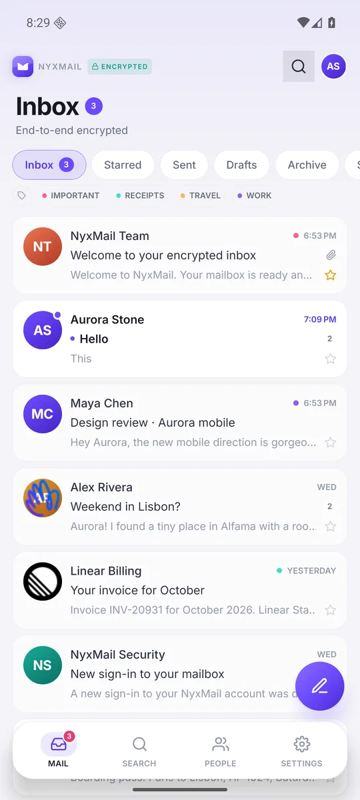
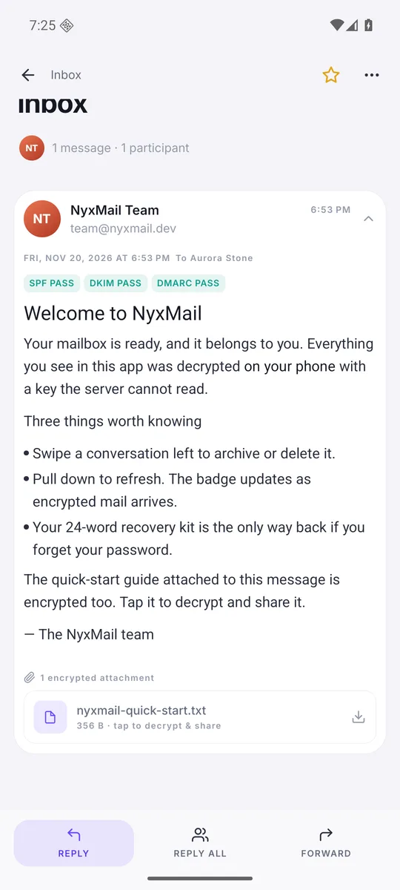
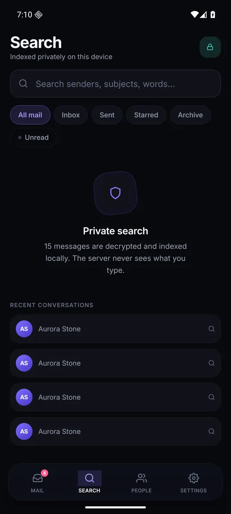

# NyxMail

**Self-hosted, zero-access encrypted webmail.**

[](LICENSE)
[](package.json)
[](web/package.json)
[](CONTRIBUTING.md)

NyxMail is a complete self-hosted mail platform: a Next.js webmail application, a
PostgreSQL schema, a background worker and a small set of pluggable
mail-infrastructure adapters. Messages, subjects, attachment keys and attachment
bytes are encrypted in the browser (or sealed by the server at ingress with the
recipient's **public** key) before they are persisted. The server never holds an
unencrypted private key.

> **Project status:** NyxMail is an early-stage, self-hosted project. It has not
> undergone an independent security audit. Read the [security model](#security-model)
> and run your own review before trusting it with sensitive mail. Security reports
> are handled through [SECURITY.md](SECURITY.md), not public issues.

> **Self-hosting:** the fastest path is the Docker stack in
> [Self-hosting quick start](#self-hosting-quick-start). Production mail delivery
> also needs DNS, an inbound MTA and TLS; see [Going live](docs/going-live.md).

```
┌──────────────────────────── Browser ─────────────────────────────┐
│ Next.js UI · libsodium-wrappers-sumo · Argon2id · WebCrypto      │
│ private key bundle in memory only · MiniSearch index in IndexedDB│
└──────────────┬──────────────────────────────────┬────────────────┘
               │ TLS                               │ SSE
┌──────────────▼──────────────────────────────────▼────────────────┐
│ web/  Next.js 14 App Router                                       │
│  · REST API under /api/v1                                         │
│  · session cookies + refresh rotation + CSRF                       │
│  · TOTP / WebAuthn / backup codes                                 │
│  · server-side HTML sanitisation, HMAC ingest webhook             │
│  · outbound relay adapters (SMTP or Console)                      │
└───────┬───────────────────────┬───────────────────┬──────────────┘
        │ Prisma                │ encrypted blobs   │ AES-GCM secrets
┌───────▼────────┐     ┌────────▼────────┐   ┌──────▼──────────────┐
│ PostgreSQL 16  │     │ uploads/ volume │   │ APP_ENCRYPTION_KEY  │
│ users, cipher- │     │ attachment and  │   │ TOTP / OAuth / IMAP │
│ text, threads  │     │ import files    │   │ credentials         │
└───────▲────────┘     └────────▲────────┘   └─────────────────────┘
        │                       │
┌───────┴───────────────────────┴───────────────────────────────────┐
│ workers/  background worker                                       │
│  · Gmail OAuth · IMAP · Proton Bridge · mbox/EML imports          │
│  · scheduled sends · 30-day trash purge · snooze wake-up          │
└───────────────────────────────────────────────────────────────────┘
        ▲
        │ signed HTTP webhook (HMAC-SHA256)
┌───────┴───────────────────────────────────────────────────────────┐
│ MTA layer (built-in mta / Haraka / Postfix / your SMTP edge)      │
│  SPF · DKIM · DMARC verdicts · MX/TLS · outbound SMTP relay       │
└───────────────────────────────────────────────────────────────────┘
```

## Contents

- [Features](#features)
- [Security model](#security-model)
- [Repository layout](#repository-layout)
- [Android app](#android-app)
- [Self-hosting quick start](#self-hosting-quick-start)
- [Local development](#local-development)
- [Demo mailbox](#demo-mailbox)
- [Environment variables](#environment-variables)
- [Proton Mail import](#proton-mail-import)
- [Gmail OAuth import](#gmail-oauth-import)
- [Development and production](#development-and-production)
- [Tests](#tests)
- [Going live with real mail](#going-live-with-real-mail)
- [API surface](#api-surface)
- [Operational notes](#operational-notes)
- [Contributing](#contributing)
- [Security](#security)
- [License](#license)

## Features

**Account & authentication**
- Signup restricted to `MAIL_DOMAIN`, Argon2id password hashing, client-side
  X25519 + Ed25519 key generation, Argon2id-protected private key bundle.
- 24-word BIP-39 recovery kit, downloadable at signup and regenerable in
  Settings → Security. Server stores only an HMAC of the phrase hash.
- Mandatory TOTP (RFC 6238) with QR enrollment, otpauth URI and 10 single-use
  backup codes. Optional WebAuthn/passkeys as an alternative second factor.
- httpOnly access + rotating refresh cookies, session device list with IP,
  user-agent and last-seen, remote revocation, CSRF double-submit tokens.
- Password change re-encrypts the private key in the browser. Recovery flow
  unwraps with the 24-word phrase and re-wraps with a new password.

**Mailbox**
- Three-pane responsive UI, dark/light themes, mobile drawers and bottom nav.
- Threaded conversations, rich text + plain text composer, drag/drop encrypted
  attachments up to 25MB each, inline images, signatures, scheduled send.
- Draft auto-save every three seconds, recovery of drafts, reply / reply-all /
  forward with `In-Reply-To` and `References` headers.
- Folders, colored labels, aliases, per-message star/read/snooze/archive/trash,
  bulk operations and Gmail-style keyboard shortcuts (`c / e # j k r a f s u ?`).
- Trash retention of 30 days; the worker purges to storage and files after that.
- SSE new-mail notifications, unread title/favicon badge, optional browser
  notifications, in-app toasts with Undo actions.
- Client-side full-text search through a decrypted MiniSearch index cached in
  IndexedDB. The server has no plaintext search index.
- Contacts auto-collected from mail, editable, vCard import/export and merge UI.
- HTML sanitised with DOMPurify on both sides; remote images blocked by default;
  per-sender image trust; remote images proxied through an authenticated,
  SSRF-hardened image proxy. Tracking pixels are stripped.
- Sender avatars from Gravatar, with initials as the fallback. The browser
  requests a same-origin hashed URL; the server performs and caches the Gravatar
  lookup, so Gravatar never sees the reader's IP address.
- Import from Gmail (OAuth read-only), generic IMAP, Proton Bridge, Proton export
  ZIP folders, mbox and EML with progress, pause/resume/cancel. Proton folders
  become folders, labels become NyxMail labels, and read/starred state is
  preserved. Client-side decrypted export to mbox or an EML zip.
- Built-in automatic filters for **Billing, Marketing, Security, Shipping,
  Travel, Newsletters, Social and Notifications**, with the familiar Primary /
  Social / Promotions / Newsletters / Transactions / Updates tabs.
- Pluggable spam engine: local **Rspamd** integration (`/checkv2`) with every
  symbol and score stored on the message, per-mailbox Bayesian learning from
  **Report spam** / **Not spam**, plus per-user allow/block lists, sender report
  history, SPF/DKIM/DMARC verdicts, spam phrase heuristics and optional DNSBL
  lookup when Rspamd is not running.
- SMTP and console transports behind a `MailTransportProvider` interface.

## Security model

NyxMail is deliberately precise about what “zero access” means.

**What is encrypted end-to-end**
- Subjects and bodies use a random 256-bit message key with
  XSalsa20-Poly1305 (libsodium `crypto_secretbox`).
- The message key is wrapped per recipient with X25519
  `crypto_box_seal`. The server stores only the wrapped keys.
- Attachments use independent XChaCha20-Poly1305 keys. Attachment keys live
  inside the encrypted message body.
- The private X25519/Ed25519 bundle is encrypted with a key derived from the
  password via Argon2id (`crypto_pwhash`, 64MB, 3 iterations). The recovery kit
  encrypts the same bundle with an independent BIP-39-derived Argon2id key.

**What the server sees**
- Envelope metadata: sender, recipients, Cc/Bcc, timestamps, folder, size and
  authentication verdicts.
- Ciphertext, per-recipient sealed message keys, encrypted attachment bytes.
- Attachment filenames and MIME types (the body also contains an encrypted copy).
  These metadata fields are used for quota and download headers.
- Public keys; encrypted TOTP secret and encrypted Gmail/IMAP/Proton Bridge
  credentials (AES-256-GCM using `APP_ENCRYPTION_KEY`).
- The server sees plaintext in these unavoidable places:
  - **Inbound external mail** while your MTA/webhook processes it. It is
    immediately sanitised, sealed to the recipient's public key and discarded.
  - **Outbound external mail** while it is relayed over SMTP. Internal-only
    delivery remains ciphertext end to end.
  - **Scheduled external sends** while queued: the SMTP payload is AES-256-GCM
    encrypted at rest until the worker sends it, then deleted.
  - **Password and TOTP codes** during TLS-authenticated requests. The derived
    Argon2 key never leaves the browser.

**Browser threat model**
- The decrypted private key lives in React memory only. Reloads and new tabs ask
  for the password again. No plaintext private key is placed in localStorage.
- The decrypted search index is stored in IndexedDB in plaintext on this device
  so that offline search is fast. Protect the device and browser profile.
- A compromised browser, malicious extension or XSS would defeat client-side
  encryption. The strict CSP, nonce-based script policy, sanitised email iframe,
  no third-party scripts and no analytics reduce that surface, but cannot
  eliminate it.
- A fully malicious server can serve modified client JavaScript. The at-rest
  zero-access guarantee protects database dumps and honest-but-curious hosting,
  not a hostile web host. Use reproducible builds and independent client
  verification if that is in your threat model.

**Active-server limitation**
- The client fetches recipients' public keys from this server. An actively
  malicious server could substitute a key at send time to obtain a copy of an
  internal message. Your own Sent copy is always sealed to the locally-held key,
  and mail at rest remains ciphertext. For an adversarial-hosting threat model,
  add key transparency / TOFU pinning to the recipient key directory.

**Cryptographic notes**
- libsodium's Argon2id implementation is used in-browser via
  `libsodium-wrappers-sumo`. Derivation is CPU/memory heavy by design.
- A 24-word BIP-39 phrase encodes 256 bits of entropy and is independently
  Argon2id-stretched. The client sends only `SHA-256(phrase)` to the server, which
  stores an HMAC of it using `RECOVERY_PEPPER`.
- The app uses versioned ciphertext envelopes (`nyx1.<nonce>.<ciphertext>` for
  secretbox, `nyxatt1...` for XChaCha20-Poly1305 attachments) so formats can be
  migrated safely.
- Ed25519 signing keys are generated and stored for future signed-envelope
  extensions; message sealing uses X25519.
- There is no password reset without the recovery kit. NyxMail cannot decrypt
  a mailbox for an administrator.

## Repository layout

```
.
├── crypto/                     @nyxmail/crypto — isomorphic crypto + unit tests
│   ├── src/index.ts            keygen, Argon2id KDF, secretbox, sealed boxes,
│   │                           attachment AEAD, recovery kit, backup codes
│   ├── src/server.ts           server-side sealing for ingress/importers
│   └── tests/crypto.test.ts
├── db/                         @nyxmail/db — Prisma schema, client, seed
│   ├── prisma/schema.prisma
│   ├── prisma/migrations/      checked-in SQL migrations
│   └── prisma/seed.ts          demo mailbox with encrypted-at-rest samples
├── server/                     @nyxmail/server — mail infrastructure layer
│   ├── src/transport.ts        MailTransportProvider, SMTPProvider, ConsoleProvider
│   ├── src/parsers.ts          EML/mbox parsing, auth-result extraction
│   ├── src/ingest.ts           webhook ingest → sanitise → seal → store
│   ├── src/spam.ts             rule engine, RBL hook, allow/block matching
│   ├── src/rspamd.ts           /checkv2 scanner + Bayes /learnspam //learnham client
│   ├── src/sanitize.ts         DOMPurify sanitisation, pixel stripping
│   ├── src/outbound.ts         encrypted send/delivery pipeline
│   ├── src/relay.ts            queued-relay envelope encryption
│   └── src/threads.ts          reference-based threading
├── shared/                     @nyxmail/shared — types + client-safe utilities
│   ├── src/types.ts
│   ├── src/utils.ts
│   ├── src/vcard.ts
│   ├── src/secrets.ts          Node-only AES-GCM/HMAC helpers
│   └── src/storage.ts          upload path resolution
├── workers/                    background worker
│   ├── src/index.ts            job claim loop + scheduled sends
│   ├── src/importers/gmail.ts
│   ├── src/importers/imap.ts
│   ├── src/importers/proton.ts     Bridge STARTTLS, folders/labels/flags
│   ├── src/importers/proton-export.ts  Export ZIP metadata reconstruction
│   ├── src/importers/file.ts
│   ├── src/importers/providers.ts  MailIngestProvider, ImapImporter,
│   │                               MboxParser, EmlParser adapters
│   ├── src/maintenance.ts       trash purge, snooze wake-up, cleanup
│   └── tests/proton.test.ts
├── web/                        Next.js 14 App Router application
│   ├── src/app/                pages + /api/v1 route handlers
│   ├── src/components/         mail, settings, auth and UI components
│   ├── src/lib/                server auth/session, crypto client, search, export
│   ├── src/middleware.ts       CSP nonce + security headers
│   ├── tests/unit/             TOTP tests
│   └── tests/e2e/              Playwright signup→send→inbox
├── mta/                        built-in SMTP receiver (smtp-server + mailauth)
├── mobile/                     React Native Android client
├── config/rspamd/              Rspamd local config + controller example
├── docs/                       production MTA, DNS, Haraka and nginx guidance
├── scripts/                    demo TOTP, secret and DKIM generators
├── .github/                    CI, CodeQL, Dependabot, issue/PR templates
├── docker-compose.yml          local Postgres, optional Rspamd/Redis
├── docker-compose.selfhost.yml web + worker + Postgres + Redis stack
├── docker-compose.prod.yml     maintainer host-network example
├── .env.example
├── SECURITY.md                 vulnerability reporting and hardening notes
├── CONTRIBUTING.md             development setup and PR checklist
├── CODE_OF_CONDUCT.md
└── README.md
```

## Android app

A native React Native client lives in [`mobile/`](mobile/README.md). It targets the
same `/api/v1` surface as the web app and implements byte-compatible client-side
encryption in pure JavaScript (Argon2id, X25519 sealed boxes, XSalsa20-Poly1305
and XChaCha20-Poly1305), because Hermes has no WebAssembly for libsodium.

- 100% native mobile components — no WebView.
- Sign-in, TOTP/backup codes, in-app signup with recovery kit, locked-key unlock.
- Encrypted inbox, threads, compose, aliases, attachments, scheduled send and
  encrypted draft autosave.
- Private on-device search, contacts, folders, labels, sessions and security.
- Release APKs are built locally; binaries are not committed.

| Inbox | Conversation | Private search |
| --- | --- | --- |
|  |  |  |

See [`mobile/README.md`](mobile/README.md) for the build, signing, test mailbox
and cryptography verification instructions.

## Self-hosting quick start

The recommended single-host stack is
[`docker-compose.selfhost.yml`](docker-compose.selfhost.yml). It runs the web app,
the background worker, PostgreSQL and Redis. Put it on a Linux host with Docker
Compose v2 and terminate TLS in Caddy, nginx or Traefik.

```bash
git clone https://github.com/your-org/nyxmail.git
cd nyxmail
cp .env.example .env
npm run keys:secrets          # paste the four generated secrets into .env
```

Edit `.env` before starting:

```dotenv
APP_URL="https://mail.example.com"
MAIL_DOMAIN="example.com"
MAIL_DOMAINS="example.com"
SIGNUP_DOMAINS="example.com"
MAIL_HOSTNAME="mail.example.com"
POSTGRES_PASSWORD="replace-with-a-long-random-password"
TRUST_PROXY="true"
# console for a local test, smtp/direct when you are ready to send real mail
OUTBOUND_TRANSPORT="console"
```

Start the database, apply migrations, then start the app and worker:

```bash
docker compose -f docker-compose.selfhost.yml up -d --build postgres redis
docker compose -f docker-compose.selfhost.yml run --rm web npm run db:migrate
docker compose -f docker-compose.selfhost.yml up -d
docker compose -f docker-compose.selfhost.yml ps
```

The web app is published on `http://127.0.0.1:3000` by default. Set
`NYXMAIL_BIND_ADDRESS` / `NYXMAIL_HTTP_PORT` to change that, and point your reverse
proxy at it. The first account created becomes the instance administrator. For a
local demo mailbox, run
`docker compose -f docker-compose.selfhost.yml run --rm web npm run db:seed`.

The compose stack does **not** run a public MX. Use the included `npm run mta`
SMTP receiver or your own Haraka/Postfix setup, publish MX/SPF/DKIM/DMARC, and
follow [Going live with real mail](docs/going-live.md).

> Never expose PostgreSQL, Redis or the worker to the internet. Back up the
> Postgres volume and the `uploads` volume together. Losing the database loses
> the mailbox even though the stored mail is encrypted.

## Local development

Requirements: Node.js ≥ 20.11, PostgreSQL ≥ 15, npm ≥ 10. Docker is optional
but convenient for Postgres. For browser crypto, `https://` or `localhost` is
required.

```bash
cp .env.example .env
npm run keys:secrets          # paste generated values into .env
docker compose up -d postgres # or point DATABASE_URL at your DB
npm install
npm run db:generate
npm run db:migrate            # applies checked-in migrations
npm run db:seed               # optional demo mailbox
npm run dev                   # web on http://localhost:3000
npm run dev:worker            # in a second terminal
```

For local source changes, create a migration with:

```bash
npm run db:migrate:dev -- --name my_change
```

The app and worker must read the same `.env` (the Next config and worker load the
repository-root file). Uploaded files are written under `UPLOAD_DIR` relative to
the repository root by default. `.env`, `uploads/`, DKIM keys and mobile signing
credentials are git-ignored; never commit them.

### Demo mailbox

`npm run db:seed` creates:

```
Email:    demo@localhost
Password: NyxMail!2025
TOTP:     JBSWY3DPEHPK3PXP    (or: npm run demo:totp)
Aliases:  hello@localhost, alias@localhost
```

The seed prints ten one-time backup codes and a 24-word recovery phrase. They are
new on each seed. Sample threads, labels, contacts, an encrypted attachment, a
completed import job and transport log are included. Re-running the seed deletes
and recreates the demo user (and its mailbox) by email.

> The demo assumes `MAIL_DOMAIN=localhost` and `APP_URL=http://localhost:3000`.
> If port 3000 is occupied, run `PORT=3100 APP_URL=http://localhost:3100 npm run dev`
> and use the matching URL.

## Environment variables

| Variable | Required | Purpose |
| --- | --- | --- |
| `DATABASE_URL` | yes | PostgreSQL connection string |
| `POSTGRES_USER` / `POSTGRES_PASSWORD` / `POSTGRES_DB` | no | credentials used by `docker-compose.selfhost.yml`; change the password before deploying |
| `NYXMAIL_BIND_ADDRESS` / `NYXMAIL_HTTP_PORT` | no | host bind address and port published by `docker-compose.selfhost.yml`, defaults `127.0.0.1` and `3000` |
| `JWT_SECRET` | yes | ≥32-byte HMAC secret for access/flow tokens |
| `APP_ENCRYPTION_KEY` | yes | 32 bytes, exactly 64 hex chars or base64; AES-256-GCM for TOTP/OAuth/IMAP/queued payloads |
| `RECOVERY_PEPPER` | yes | server HMAC pepper for recovery phrase hashes |
| `INGEST_SECRET` | yes | HMAC secret for `/api/v1/ingest` |
| `APP_URL` | yes | canonical origin, cookies, WebAuthn RP origin, OAuth redirects |
| `MAIL_DOMAIN` | yes | primary domain for generated Message-IDs and defaults |
| `MAIL_DOMAINS` | no | optional bootstrap extra domains; domains can also be added in Settings → Domains |
| `SIGNUP_DOMAINS` | no | optional signup allow-list; defaults to `MAIL_DOMAIN` and can be toggled per domain in Settings → Domains |
| `CATCH_ALL_MAP` | no | optional bootstrap catch-all map, e.g. `{"example.net":"you@example.com"}` |
| `NEXT_PUBLIC_REPOSITORY_URL` | no | optional GitHub/source URL shown on the landing page |
| `CATCH_ALL_DOMAIN` / `CATCH_ALL_ADDRESS` | no | optional single-domain catch-all shorthand |
| `UPLOAD_DIR` | no | file storage root (default `uploads/`) |
| `DEFAULT_STORAGE_LIMIT_BYTES` | no | per-user quota, default 1.5 GiB |
| `RBL_ZONE` | no | DNSBL zone appended to reversed sender IPs |
| `RSPAMD_URL` | no | local Rspamd normal worker, e.g. `http://127.0.0.1:11333`; empty disables Rspamd |
| `RSPAMD_CONTROLLER_URL` | no | Rspamd controller for `/learnspam`, `/learnham`, default `http://127.0.0.1:11334` |
| `RSPAMD_PASSWORD` | no | controller password; copy `config/rspamd/worker-controller.example.inc` to the git-ignored `worker-controller.inc` and use the same value |
| `RSPAMD_SPAM_SCORE` | no | score threshold for filing spam, default `6` |
| `RSPAMD_TIMEOUT_MS` / `RSPAMD_MAX_BYTES` | no | scan timeout (default 8s) and maximum raw message size (default 25 MiB) |
| `TRUST_PROXY` | no | set `true` behind a trusted reverse proxy to use `X-Forwarded-For` |
| `OUTBOUND_TRANSPORT` | no | `direct` (built-in MX delivery), `smtp` (external relay) or `console` (development) |
| `SMTP_DIRECT_LOCAL_ADDRESS` / `SMTP_DIRECT_HELO` | no | source IPv4 and EHLO hostname for direct delivery |
| `SMTP_DIRECT_PORT` / `SMTP_DIRECT_REQUIRE_TLS` | no | defaults to `25` and `true` |
| `SMTP_HOST` | no | relay host, used when `OUTBOUND_TRANSPORT="smtp"` |
| `SMTP_PORT` / `SMTP_SECURE` | no | outbound relay SMTP settings |
| `SMTP_USER` / `SMTP_PASSWORD` | no | outbound relay SMTP auth |
| `SMTP_FROM` | no | default envelope-from identity for relay mode |
| `SMTP_INBOUND_HOST` / `SMTP_INBOUND_PORT` | no | built-in `npm run mta` listener; defaults to `0.0.0.0:2525` |
| `SMTP_INBOUND_MAX_BYTES` | no | maximum inbound message size for the built-in MTA |
| `SMTP_TLS_KEY_PATH` / `SMTP_TLS_CERT_PATH` | no | PEM files for STARTTLS in the built-in MTA |
| `GOOGLE_CLIENT_ID` / `GOOGLE_CLIENT_SECRET` | no | Gmail OAuth import |
| `GOOGLE_REDIRECT_URI` | no | defaults to `${APP_URL}/api/v1/imports/gmail/callback` |
| `REDIS_URL` | no | shared rate limiting; app degrades to in-memory |
| `WORKER_POLL_INTERVAL_MS` | no | worker poll interval, default 3000 |
| `IMAP_ALLOW_PRIVATE_HOSTS` | no | allow IMAP imports to private/localhost addresses; false by default to limit SSRF |
| `MAIL_HOSTNAME` | no | MX/mail hostname used by the DNS helper; defaults to the `APP_URL` host |
| `MAIL_SERVER_IPV4` / `MAIL_SERVER_IPV6` | no | optional addresses shown as A/AAAA and PTR records |
| `DKIM_SELECTOR` | no | default DKIM selector, shown in DNS setup, default `nyxmail` |
| `DKIM_PUBLIC_KEY_MAP` | no | optional bootstrap map of domain → DKIM public key; new domains store keys in the database |
| `DKIM_PUBLIC_KEY` | no | optional fallback public key for the primary domain |
| `SPF_RECORD` | no | override the generated SPF record (for example with a relay include) |
| `DMARC_POLICY` | no | generated DMARC policy, default `quarantine` |
| `DMARC_REPORT_EMAIL` | no | DMARC aggregate report mailbox; defaults to `dmarc@<domain>` |
| `APP_INTERNAL_URL` | no | internal URL used by maintenance scripts, default `http://127.0.0.1:3000` |

Generate the four secrets with `npm run keys:secrets`. Never commit `.env`.

## Custom domains and catch-all

NyxMail can receive on multiple domains and route unmatched local parts through
a per-domain catch-all. Domain management is available to the **instance
administrator** under **Settings → Domains**; no `.env` edit or restart is
required for new domains. The first account created becomes the administrator,
and the migration promotes the oldest existing account.

### Add a domain

1. Open **Settings → Domains** and choose **Add domain**.
2. Enter the domain (for example `example.net`), optionally set a catch-all
   mailbox and choose whether public signup is allowed.
3. Keep **Generate a DKIM key automatically** enabled. NyxMail creates a
   2048-bit RSA key pair, stores the private key encrypted in Postgres with
   `APP_ENCRYPTION_KEY`, and uses it to sign outbound mail from that domain.
4. Publish the MX, SPF, DKIM and DMARC records shown on the page. The DNS status
   check verifies them in public DNS.
5. Send a test message to a random address such as
   `hello-test@example.net`.

Domains added this way are read immediately by the web app, worker and built-in
MTA. If you run Haraka or Postfix in front of NyxMail, also add the domain to its
accepted/local domain list (`host_list` or `relay_domains`).

Exact users and aliases always take precedence over the catch-all. So an alias
`support@example.net` owns that address; `anything-else@example.net` falls
through to the configured catch-all mailbox. Catch-all targets may be a user or
an alias, but chained catch-alls are not resolved.

Catch-all does **not** automatically create sendable identities. The mailbox
receives the mail with the original envelope address in `To`, but to send from a
specific address, add it under **Settings → Account → Aliases** (or use the alias
API). The alias domain selector includes every hosted domain.

Use **Manage** next to a domain to change its signup or catch-all settings, or to
rotate its DKIM key. Removing a domain deletes its stored DKIM key; existing
mailboxes and aliases are left untouched but stop receiving new mail on that
domain.

> Catch-all addresses receive a lot of dictionary spam. Per-user block/allow
> rules, SPF/DKIM/DMARC checks and normal spam routing still apply. Consider
> restricting signup to your primary domain and creating only the aliases you
> actually need to send from.

### Environment bootstrap (optional)

Existing installations can keep using environment variables. They are merged
with database-managed domains and remain useful for the primary identity:

```dotenv
MAIL_DOMAIN="example.com"
MAIL_DOMAINS="example.com,example.net"
SIGNUP_DOMAINS="example.com"
CATCH_ALL_MAP='{"example.net":"you@example.com"}'
```

- `MAIL_DOMAIN` is always the primary domain (Message-ID generation, defaults).
- A database row can override signup/catch-all/DKIM settings for an environment
  domain, but the environment domain itself cannot be removed from the UI.
- `SIGNUP_DOMAINS` and catch-all map keys only take effect for domains that are
  also mail domains.
- To migrate fully to database management, remove the extra domains and
  catch-all entries from `.env`, run `npm run db:migrate`, then manage them in
  Settings → Domains.

`GET /api/v1/domains` returns the configured mail/signup domains, their
catch-all targets and whether the current user can manage them.
`GET /api/v1/config` exposes the signup domains to the signup page and is safe to
cache briefly. `POST /api/v1/domains` adds a domain and
`PATCH`/`DELETE /api/v1/domains/[domain]` update or remove it; all three require
an administrator session.

### Operational notes for additional domains

- Aliases are first-come, first-served within the instance. On a multi-user
  deployment, add explicit aliases for the addresses you want to reserve.
- The catch-all target must resolve to a hosted user or active alias. Pointing it
  at an external address will not forward mail.
- DNS/MTA changes are outside the app: NyxMail only sees the envelope recipients
  that your MTA posts to `/api/v1/ingest`.
- If you rotate a DKIM key, publish the new TXT record promptly. Mail signed with
  the old key can fail DKIM while DNS caches the previous value.

## Sieve-style mail filters

Settings → **Filters** provides ordered server-side rules for incoming mail. A rule has a
name, an ALL/ANY match mode and up to 20 conditions. Available fields:

- From address, From display name, sender domain
- To, Cc, delivered-to address
- Subject, body text/HTML, any header or body text
- Attachment name, has-attachment, total message size
- Spam score, SPF, DKIM and DMARC verdicts

Operators include contains / does not contain, equals, starts/ends with, safe `*`/`?` glob
patterns, and numeric comparisons. Actions can move to a folder, add one or more labels,
mark read or unread, star/unstar, archive, move to Spam, move to Trash, and optionally stop
processing later rules. Folder actions run in order; the last folder action wins.

### Raw Sieve

Each filter can also be created in **Raw Sieve** mode. The editor validates the script,
shows the compiled conditions/actions, and stores the original script so it can be edited
again later. Raw filters are compiled into the same condition/action model as the visual
editor, so they run through exactly the same ingress path.

Supported subset:

- `require` lists (parsed and ignored for engine selection)
- `if` with `header`, `address`, `body` and `size` tests
- `allof`, `anyof` and a single-test `not`
- `:contains`, `:is`, `:matches`, and `:over`/`:under` for size
- `fileinto`, `addlabel` (NyxMail extension), `addflag`/`setflag`/`removeflag`,
  `stop`, and `keep`
- `\Seen` and `\Flagged` flags

Use one `if` block per filter; create separate filters for `elsif`/`else` branches or
mixed nested boolean groups. `redirect`, `discard`, `vacation`, `reject` and `notify`
are disabled. Folder and label names must already exist. Example:

```sieve
require ["fileinto", "imap4flags"];

if allof (
  header :contains "From" "github.com",
  header :contains "Subject" "[build]"
) {
  fileinto "Dev";
  addflag "\\Seen";
  stop;
}
```

Validate without saving with `POST /api/v1/rules/sieve/validate`; create/update raw rules
with `mode: "SIEVE"` and `sieveScript` on the normal rules API.

Rules are evaluated at SMTP ingress before the message is encrypted for storage. They apply
to inbound internet mail (including catch-all recipients) and are stored encrypted at rest
like all other mail. They do not run on historical imports or on messages sent directly
between local encrypted mailboxes, because the server never sees those plaintext bodies.
Changes apply to future mail only. Filter definitions are stored server-side in plaintext
because the worker/web ingress must evaluate them; do not put secrets or sensitive message
content into condition values. They are visible to a database administrator just like spam
allow/block rules.

API: `GET/POST /api/v1/rules`, `PATCH/DELETE /api/v1/rules/[id]`,
`POST /api/v1/rules/reorder`, `POST /api/v1/rules/sieve/validate`.

## Spam filtering with Rspamd

NyxMail ships an optional local [Rspamd](https://rspamd.com/) sidecar. It sees
the raw MIME message during SMTP delivery — the same trust boundary as the MTA —
so it can inspect HTML, URLs, attachments, inline images and fuzzy image hashes.
Stored mail remains encrypted and is never sent to Rspamd later.

```bash
docker compose up -d rspamd
```

The compose service uses host networking and binds Rspamd to loopback:

- `11333` — normal worker (`POST /checkv2`)
- `11334` — controller (`POST /learnspam`, `POST /learnham`)

Configuration lives in `config/rspamd/local.d/`. Copy the sample controller
config (the real file is git-ignored), set a password, and use the same value in
`.env` (`RSPAMD_PASSWORD`):

```bash
cp config/rspamd/worker-controller.example.inc \
   config/rspamd/local.d/worker-controller.inc
# edit both files, then restart rspamd
docker compose up -d --force-recreate rspamd
```

Relevant settings:

```dotenv
RSPAMD_URL="http://127.0.0.1:11333"
RSPAMD_CONTROLLER_URL="http://127.0.0.1:11334"
RSPAMD_PASSWORD="change-me-rspamd-controller"
RSPAMD_SPAM_SCORE="6"
RSPAMD_TIMEOUT_MS="8000"
RSPAMD_MAX_BYTES="26214400"
```

If Rspamd is unavailable, NyxMail automatically falls back to the built-in
heuristics, so mail delivery does not stop. `/api/v1/spam/status` reports whether
the scanner and controller are reachable.

Every scan result is stored on the message (`spamScore`, `spamAction`,
`spamEngine`, `spamSymbols`). Open a message and expand **Spam analysis** to see
the total score and every symbol that fired.

### Training from user actions

When a user chooses **Report spam**, the browser decrypts that message, builds a
small RFC822 sample, and posts it with the report. The server forwards it to
Rspamd's `/learnspam`. **Not spam** does the same through `/learnham`, moves the
message back to Inbox, and removes the sender's automatic block entry. The Bayes
classifier is configured per mailbox with SQLite storage, so feedback from one
user does not affect another user's model.

The explicit training sample is the only time a decrypted body leaves the
browser after delivery. It is optional; the report still moves the message and
updates sender statistics when no sample is supplied.

## DNS setup for custom domains

Settings → **Domains** shows every configured mail domain and generates copy-ready records:

- MX: `10 <MAIL_HOSTNAME>.`
- SPF: `v=spf1 mx -all` (or `SPF_RECORD`)
- DKIM: `<DKIM_SELECTOR>._domainkey` with your public key
- DMARC: policy + aggregate reports
- A/AAAA for the mail host, plus an explicit PTR/rDNS reminder
- Catch-all, primary and signup badges per domain
- Live public-DNS status for every MX, SPF, DKIM, DMARC, A/AAAA and PTR record
- Per-record copy buttons, a copy-all button and downloadable BIND-style zone files
- Automatic checks on page load and a **Check DNS** / **Re-check** button

Domains added under **Settings → Domains** get a DKIM key pair automatically;
the private key is encrypted in Postgres and used by the outbound transport. Use
**Manage → Rotate the DKIM key** to replace it.

For legacy installations that sign from `config/dkim/<domain>.private`, the CLI
helper is still available:

```bash
npm run dkim:generate -- example.com
```

It writes a 2048-bit private key to `config/dkim/example.com.private` (mode
`0600`, git-ignored) and adds the public key to `DKIM_PUBLIC_KEY_MAP` in `.env`.
Restart web + worker afterwards, and publish the TXT record shown by the command.

To make the DNS tab complete, configure `MAIL_HOSTNAME`, `MAIL_SERVER_IPV4`/`IPV6`,
`DKIM_SELECTOR`, optional `SPF_RECORD`, `DMARC_POLICY` and `DMARC_REPORT_EMAIL`.
Database-managed DKIM keys take precedence over `DKIM_PUBLIC_KEY_MAP`.

The generated records are guidance, not a substitute for checking your DNS provider's
handling of TXT quoting, apex records and proxy/email-routing settings. If a provider such as
Cloudflare has Email Routing enabled, disable it or point MX at this mail host deliberately.

## Proton Mail import

There are two Proton paths. The **Proton Export Tool** path is best if you
already have an exported folder; Proton Bridge is best for a live mailbox.

### Import a Proton export folder (no Bridge)

1. Download your mailbox with the official **Proton Mail Export Tool**. It
   produces a folder such as:
   ```
   you@proton.me/
   └── mail_20260101_120000/
       ├── labels.json
       ├── message-id.eml
       ├── message-id.metadata.json
       └── ...
   ```
2. Zip the `mail_*` folder itself. Keep `labels.json`, the `.eml` files and the
   `.metadata.json` sidecars together.
3. Open **Settings → Imports → Proton export folder (ZIP)** and upload the ZIP.
4. Keep the worker running.

The export importer:

- reconstructs Inbox/Sent/Drafts/Archive/Spam/Trash
- recreates Proton custom folders, including nested paths such as `Work/2024`
- imports Proton tags as NyxMail labels
- merges multiple tags on one message
- preserves read/unread and starred state from Proton metadata
- skips `All Mail`/`Starred` aggregate labels so messages are not duplicated
- imports `Drafts` messages as editable drafts
- falls back to Inbox when metadata is absent
- encrypts every message to your NyxMail public key as it imports

The ZIP upload limit is 2GB. If a reverse proxy or Cloudflare sits in front of
NyxMail, its upload limit may be lower; raise it or perform the import through a
local deployment. Messages that Proton's export could not assemble into an
`.eml` file are skipped. A 2GB+ export can be split into multiple exports/ZIPs
and imported as separate jobs.

### Import a live mailbox with Proton Bridge

Proton does not expose a hosted IMAP endpoint. Proton Bridge runs locally,
decrypts your Proton mailbox and exposes it over IMAP.

1. Install and sign in to Proton Bridge on a machine the NyxMail **worker** can
   reach. Complete Proton 2FA in Bridge.
2. In Bridge, reveal the IMAP credentials. The username is your Proton address;
   the password is the per-client Bridge password, not your Proton password.
3. Open **Settings → Imports → Proton Mail via Bridge** in NyxMail. Defaults:
   host `127.0.0.1`, port `1143`, STARTTLS. Bridge's certificate is self-signed,
   so the dedicated importer accepts it only for this connection.
4. Start the import and keep the worker running.

Proton exposes standard folders and custom folders as IMAP folders, and labels
under `Labels/...`. The Proton importer:

- imports normal folders into local folders, preserving nested folder names
  (`Folders/Projects/NyxMail` → `Projects / NyxMail`)
- imports `Labels/...` as NyxMail labels instead of folders
- merges messages that appear in both a folder and one or more label mailboxes,
  so a message is not duplicated but receives all labels
- preserves `\Seen` and `\Flagged` as read and starred state
- skips `All Mail` and `Starred` aggregate mailboxes to avoid duplicate copies

If Bridge is on the same machine as the worker, loopback is allowed. If it is on
another machine on a private network, set `IMAP_ALLOW_PRIVATE_HOSTS=true` and
expose it only over a trusted private network or SSH tunnel. Never expose Bridge
port 1143 to the internet. For a hosted NyxMail instance that cannot reach your
desktop Bridge, run the worker locally or use Proton's export tool and the
mbox/EML uploader; those file imports preserve messages but not Proton labels.

## Gmail OAuth import

Gmail can be connected for **read-only import** and, optionally, to **send from
that Gmail address** using the Gmail API. This is not “Sign in with Google” for
NyxMail: login remains password + mandatory TOTP because the private key is
derived from the password on your device.

1. Create a Google Cloud project and enable **APIs & Services → Library → Gmail API**.
   The Gmail scope will not appear in the scope picker until this API is enabled
   in the same project.
2. Configure an OAuth consent screen. For a private self-hosted instance, use
   “External” and add your account as a test user, or use an internal Workspace app.
3. Open **Data Access → Add or remove scopes**, filter for Gmail API and select
   both `https://www.googleapis.com/auth/gmail.readonly` and
   `https://www.googleapis.com/auth/gmail.send`. If they are not in the picker,
   use **Manually add scopes** and paste each URL. Do not add `openid` or `email`:
   those are standard OIDC scopes, are not listed in the consent-screen picker,
   and NyxMail no longer requests them. Existing read-only connections must be
   reauthorized once to grant sending.
4. Create an OAuth 2.0 Client ID of type **Web application**.
5. Add the authorized redirect URI. It must match your deployment exactly:
   `https://mail.example.com/api/v1/imports/gmail/callback`
6. Set these in the server `.env` and restart web + worker:
   ```dotenv
   GOOGLE_CLIENT_ID="..."
   GOOGLE_CLIENT_SECRET="..."
   GOOGLE_REDIRECT_URI="https://mail.example.com/api/v1/imports/gmail/callback"
   ```
7. In NyxMail open **Settings → Imports → Connect Gmail** and grant read-only
   access. The same steps are shown inside the Imports tab.

Requested scopes: `gmail.readonly` and `gmail.send`. The worker requests an
offline refresh token with `access_type=offline&prompt=consent`, stores it
AES-GCM encrypted, and uses PKCE. The Google address is read from the Gmail
profile endpoint. Google credentials are never used to decrypt mail or to sign
in to NyxMail.

**Sending from Gmail identities.** Both clients list connected Gmail accounts in
the composer's **From** menu. In the mobile app, use **From → Reconnect Gmail /
add another** if the account is missing or needs reauthorization. Do **not** use
**Settings → Imports → Connect Gmail** just to enable sending: that button starts
a mailbox import. Reauthorizing an already-connected Gmail account no longer
creates a duplicate import job.

Messages to external recipients are sent by the Gmail API from that address and
are signed by Google; internal NyxMail recipients still get the encrypted local
copy. The encrypted NyxMail Sent copy is retained for every message. Mail sent
through Gmail necessarily leaves NyxMail's end-to-end encryption for those
external recipients, because Google must process the plaintext to deliver it.

The mobile connect flow uses a signed OAuth state token and returns to the app
through the `nyxmail://gmail-connected` scheme, so the browser does not need a
NyxMail session. If you change the OAuth scopes or Google client after connecting,
reauthorize the account from the same From menu.

After the initial mailbox backfill, the worker checks each connected Gmail
account every 60 seconds and imports newly arrived messages. Multiple Gmail
accounts can be connected; each gets its own encrypted refresh token and sync
state. Gmail API quota errors are retried with exponential backoff. If the
Google OAuth app remains in Testing mode, Google expires refresh tokens after
about seven days; publish the app or use an Internal Workspace app for a
permanent sync.

If you want a true Google SSO login for the NyxMail web account itself, that is a
separate feature from this import flow. It would still require unlocking the
password-derived private key unless you deliberately introduce a key-escrow or
passkey-based key-wrapping design.

## Development and production

**Development**
- `ConsoleProvider` logs outbound external messages to the database transport log
  instead of connecting to SMTP. Set `OUTBOUND_TRANSPORT="direct"` or configure
  an `smtp` relay to test real delivery.
- The in-process rate limiter is used unless `REDIS_URL` is set.
- SSE and the import worker are process-local. Run one web process and one worker.
- The strict CSP includes `'unsafe-eval'` only when `NODE_ENV !== production` (for
  Next's development runtime). Production gets a nonce-based strict policy plus
  `'wasm-unsafe-eval'` for libsodium WebAssembly.
- Cookies are marked `Secure` automatically when `NODE_ENV=production` or
  `APP_URL` begins with `https://`.

**Production**
- Terminate TLS in nginx/Caddy/Traefik. Set `APP_URL` to the public HTTPS origin.
- Run `npm run build` then `npm run start`, and `npm run worker` as a separate
  service. Both need the same env vars and volumes.
- Put PostgreSQL and the uploads directory on durable storage; back both up.
- Set `REDIS_URL` if you run more than one web/worker replica.
- Run the worker for imports, scheduled sends, trash purge and snooze wake-ups.
- Rotate `APP_ENCRYPTION_KEY` only with a planned re-encryption migration; changing
  it makes stored TOTP secrets, OAuth tokens, IMAP credentials and queued relay
  payloads undecryptable.
- `APP_ENCRYPTION_KEY` does **not** decrypt message content.

**Docker (web + worker)**

For a standard deployment, use [`docker-compose.selfhost.yml`](docker-compose.selfhost.yml)
as shown in [Self-hosting quick start](#self-hosting-quick-start). It brings up
Postgres, Redis, the web app and the worker on an isolated network.

[`docker-compose.prod.yml`](docker-compose.prod.yml) is a maintainer example for a
host-network deployment where PostgreSQL and the reverse proxy live on the host.
Adjust paths, ports and `DATABASE_URL` before using it. In both cases, rebuild
and recreate after code or `.env` changes:

```bash
docker compose -f docker-compose.selfhost.yml up -d --build --force-recreate
docker compose -f docker-compose.selfhost.yml logs -f web worker
```

Uploads are mounted from `./uploads`. The inbound SMTP gateway can run as a
systemd service (`npm run mta`) or as Haraka/Postfix in front of
`/api/v1/ingest`; see [Going live](docs/going-live.md).

## Tests

```bash
npm test                      # crypto, TOTP, EML/mbox parsers
npm run test:e2e              # Playwright signup → 2FA → compose → send → inbox
cd mobile && npm run typecheck && npm run test:crypto
```

The e2e suite needs a running web server and database. Either let Playwright start
`npm run dev` on port 3000, or set `PLAYWRIGHT_BASE_URL`:

```bash
PLAYWRIGHT_BASE_URL=http://localhost:3100 npm run test:e2e
```

Covered:
- `crypto/tests/crypto.test.ts` — key bundle round-trip, wrong-password failure,
  recovery phrase, multi-recipient sealing, attachment AEAD, backup codes.
- `web/tests/unit/totp.test.ts` — TOTP verification, otpauth URI, malformed codes,
  backup-code hashing.
- `server/tests/parsers.test.ts` — EML headers/attachment parsing, mbox splitting,
  mboxrd unescaping, auth-result parser.
- `server/tests/rules.test.ts` — Sieve-style condition matching, glob/numeric/auth
  conditions, action ordering, label/read/star actions and stop-processing.
- `server/tests/dns.test.ts` — MX/SPF/DKIM/DMARC/A/AAAA/PTR generation, DNS overrides.
- `workers/tests/proton.test.ts` — Proton Bridge label/folder naming, duplicate
  aggregate mailbox skipping, and Proton export metadata/folder/tag resolution.
- `web/tests/e2e/signup-mail.spec.ts` — full signup, recovery kit, TOTP
  enrollment, internal encrypted send, inbox read, and reload-unlock gate.
- `mobile/scripts/crypto-compat.ts` — cross-checks the React Native wire formats
  against the web libsodium implementation.

## Going live with real mail

The short version:

1. **DNS:** `A/AAAA` for `mail.example.com`, `MX 10 mail.example.com`, SPF
   `v=spf1 mx -all`, a DKIM selector TXT record from your signer, and a DMARC
   policy (`p=quarantine`, then `p=reject`). Publish a matching PTR.
2. **Inbound MTA:** receive SMTP on port 25 with TLS, validate SPF/DKIM/DMARC,
   then POST the raw MIME to `/api/v1/ingest` with the HMAC headers. Haraka plugin
   sample: [`docs/haraka/nyxmail_ingest.js`](docs/haraka/nyxmail_ingest.js).
3. **Outbound:** NyxMail can deliver directly with `OUTBOUND_TRANSPORT="direct"`,
   binding to the public IPv4 that matches your MX/PTR/SPF records and signing
   with the database-managed DKIM key or `config/dkim/<domain>.private`. Set
   `SMTP_DIRECT_LOCAL_ADDRESS` and `SMTP_DIRECT_HELO` accordingly. If outbound
   port 25 is blocked, use
   `OUTBOUND_TRANSPORT="smtp"` with a local Postfix or an authenticated relay
   instead; ensure SPF authorizes that path and it preserves the DKIM signature.
4. **Web:** put Next.js behind HTTPS, set `APP_URL`, run the worker, back up
   Postgres and uploads.
5. **Harden:** use `TRUST_PROXY=true` only behind a trusted proxy, set `REDIS_URL`,
   restrict admin/database access, and never expose PostgreSQL or the worker.

Full DNS examples, Postfix/Haraka notes, HMAC details, systemd/nginx samples and a
production checklist are in [`docs/going-live.md`](docs/going-live.md).

### Ingest webhook contract

The MTA sends `POST /api/v1/ingest` with:

```
X-NyxMail-Timestamp: <unix seconds or milliseconds>
X-NyxMail-Signature: HMAC-SHA256(hex, `${timestamp}.${rawJsonBody}`, INGEST_SECRET)
Content-Type: application/json

{
  "envelopeFrom": "sender@example.net",
  "envelopeTo": ["you@example.com"],
  "rawMimeBase64": "...",
  "authResults": { "spf": "pass", "dkim": "pass", "dmarc": "pass" }
}
```

The timestamp must be within five minutes. Delivery is idempotent per
`Message-ID` per user. The webhook sanitises the HTML, strips tracking pixels,
encrypts attachments with new random keys, seals the whole message to each local
recipient's public key with libsodium, and stores only ciphertext.

## API surface

All endpoints are under `/api/v1`. Mutating authenticated endpoints require the
`x-csrf-token` header matching the `nyx_csrf` cookie. Responses are JSON except
attachments, vCard export and SSE.

- Auth: `auth/signup`, `auth/login`, `auth/verify`, `auth/webauthn/{options,verify}`,
  `auth/two-factor/{setup,enable}`, `auth/backup-codes`, `auth/password`,
  `auth/recovery/{start,complete}`, `auth/recovery-kit`, `auth/refresh`,
  `auth/session`, `auth/logout`
- Keys & passkeys: `keys`, `passkeys`, `passkeys/options`, `passkeys/[id]`
- Account: `account`, `aliases`, `domains`, `sessions`, `folders`, `labels`,
  `contacts`, `contacts/vcard`, `contacts/merge`, `filters`
- Mail: `threads`, `threads/[id]`, `threads/[id]/labels`, `messages/[id]`,
  `messages/[id]/report-spam`, `messages/[id]/report-ham`, `messages/bulk`,
  `messages/draft`, `messages/send`, `messages/unread-count`,
  `messages/search-index`, `spam/status`, `scheduled`, `attachments`,
  `attachments/[blobId]`, `proxy/image`, `events`
- Rules & domains: `rules`, `rules/[id]`, `rules/reorder`, `domains`,
  `domains/[domain]`, `domains/dns`, `domains/dns/status` (domain mutations require an administrator)
- Import/export: `imports`, `imports/[id]`, `imports/proton`,
  `imports/proton-export`, `imports/upload`, `imports/gmail/{start,callback}`
- Public config: `config` (signup domains only)
- Ingest: `ingest` (HMAC-authenticated, no cookie)

## Dependency audit status

`npm audit --omit=dev` is not completely clean in November 2026 because the
project is pinned to **Next.js 14** as specified. The registry flags cumulative
advisories affecting every Next.js release before 16.4.6 (the specification
requires Next 14) and an attestation-chain advisory in SimpleWebAuthn 10.

What is patched here: uncaught Zod/Zod mini advisories were removed by upgrading
to Zod 4, Nodemailer to 10.6+, and PostCSS to 8.5.23 (including the nested
copy). NyxMail does not use image optimization (`unoptimized: true`), rewrites,
i18n routing, Server Actions, `next/script`, or custom image domains, which
removes the most relevant Next 14 attack surfaces. Public deployments should add
request-size limits and rate limits at the reverse proxy as well.

WebAuthn registration requests `attestationType: "none"` and NyxMail intentionally
does not use attestation trust chains to make authorization decisions, so the
SimpleWebAuthn attestation advisory does not affect the current flow. Plan an
upgrade to Next 16 and SimpleWebAuthn 14 when the Next 14 stack requirement can
be relaxed; both upgrades have breaking API changes.

Run the audit yourself with `npm audit --omit=dev`; do not treat this note as a
substitute for your own security review.

## Operational notes

- **Storage:** attachment/import files live outside Postgres under `UPLOAD_DIR`.
  Database rows contain paths and encrypted metadata. Back up both atomically.
- **Quota:** uploads and messages increment `storageUsedBytes`; the worker and
  delete routes decrement it. Orphaned uploads after a cancelled composer are not
  currently garbage-collected; schedule a future cleanup job if disk pressure
  matters.
- **Search:** the browser downloads up to 5,000 recent messages, decrypts them,
  and caches a MiniSearch index in IndexedDB. New-mail events invalidate it.
- **Scheduling:** a scheduled external send necessarily lets the server decrypt
  the queued payload at send time; it is AES-GCM-encrypted at rest until then.
  Internal-only messages remain ciphertext throughout.
- **Rate limiting:** fixed windows keyed by IP/user, hashed in memory or Redis.
  In-memory limits reset on process restart and are per-process.
- **Scaling:** the SSE route polls Postgres so it works across replicas. The
  worker currently claims one import job at a time; multiple workers are safe via
  optimistic status claims but a single worker is recommended.
- **Backups and restore:** test restoring Postgres and uploads together. Without
  the user's password/recovery phrase, restored ciphertext is still unreadable.

## Contributing

Contributions are welcome. Read [CONTRIBUTING.md](CONTRIBUTING.md) for the local
setup, test commands and pull-request checklist. Please follow the
[Code of Conduct](CODE_OF_CONDUCT.md).

Never commit `.env` files, `uploads/`, DKIM private keys, mobile signing keys,
APKs or mailbox exports. If you find a credential in the working tree, rotate it
and report it privately.

## Security

Please report vulnerabilities through the private process in
[SECURITY.md](SECURITY.md), not in a public issue. NyxMail has not received an
independent security audit. The at-rest zero-access design does not protect
against a malicious server serving modified client code; review the
[security model](#security-model) before deployment.

## License

MIT. See [LICENSE](LICENSE).
